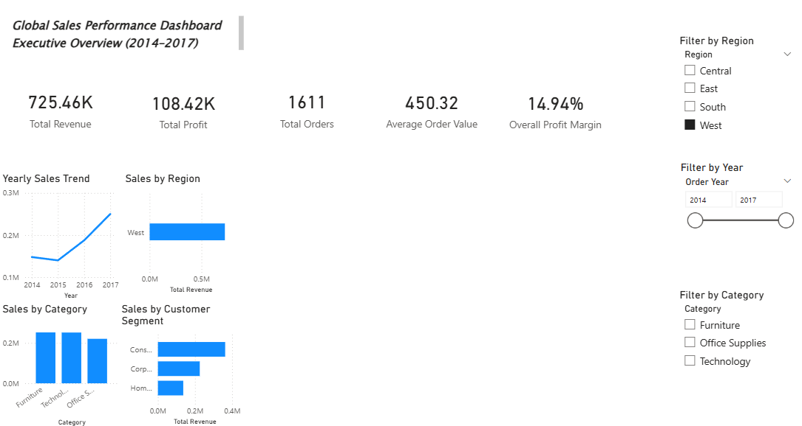
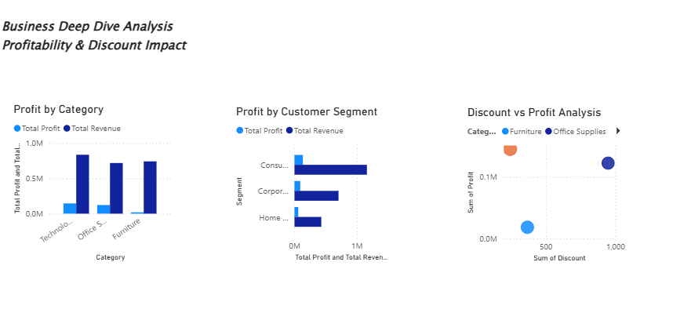

<div align="center">

# GLOBAL SALES
### Performance & Intelligence

**A data-driven exploration of revenue, profitability and business performance.**

An end-to-end retail analytics project transforming raw transaction data into business insights using Python, SQL and Power BI.

<br>

[](notebooks/)
[](sql/business_analysis.sql)
[](global_sales_dashboard.pbix)
[](#business-questions)

</div>

---

## The story behind the data

Sales figures alone do not explain business performance. Revenue can grow while profitability weakens, strong regional results can hide underperforming categories, and aggressive discounts can erode margins.

This project explores those questions through a structured analytics workflow—from cleaning and exploration to SQL analysis and interactive executive reporting.

<div align="center">

| **~$2.29M** | **~$286K** | **~12.47%** | **9,994+** |
|:---:|:---:|:---:|:---:|
| Revenue | Profit | Profit margin | Sales records |

</div>

*Metrics are approximate and reflect the current project documentation. The currency shown in the source summary has not been independently verified.*

---

## Explore the dashboard

### 01 / Executive overview

Get a high-level view of business performance through revenue, profit, margin, orders and average order value. Explore yearly trends and compare regions, categories and customer segments using interactive filters.

<div align="center">



<sub>EXECUTIVE OVERVIEW · KPI MONITORING · SALES TRENDS</sub>

</div>

### 02 / Deep-dive analysis

Move beyond headline KPIs to investigate category profitability, customer-segment contribution and the relationship between discount levels and profit.

<div align="center">



<sub>PROFITABILITY · DISCOUNT ANALYSIS · BUSINESS RISK AREAS</sub>

</div>

---

## Questions worth investigating

This analysis was designed around practical business questions:

| Area | Question |
|---|---|
| Performance | What are the overall revenue, profit and margin? |
| Geography | Which regions contribute most strongly to performance? |
| Product mix | Which categories generate revenue but have weaker margins? |
| Pricing | How are discount levels associated with profitability? |
| Customers | Which customer segments contribute the most revenue? |

---

## From raw data to decisions

<div align="center">

<table>
<tr>
<td align="center" width="25%">

**01**

### Prepare

</td>
<td align="center" width="25%">

**02**

### Explore

</td>
<td align="center" width="25%">

**03**

### Query

</td>
<td align="center" width="25%">

**04**

### Communicate

</td>
</tr>
<tr>
<td valign="top">Clean records, inspect missing values and duplicates, correct data types and engineer date features.</td>
<td valign="top">Explore time trends, regional performance, category margins and customer segments.</td>
<td valign="top">Calculate KPIs and profitability metrics using SQLite and validate analytical results.</td>
<td valign="top">Present findings through a two-page Power BI report designed for business users.</td>
</tr>
</table>

</div>

### Python — data preparation & exploration

The notebooks use pandas and NumPy to prepare the dataset, with Matplotlib and Seaborn for exploratory visualisation.

- Missing-value, duplicate and data-type checks
- Date preparation and engineered analytical features
- Revenue and profit distribution analysis
- Time-based and regional comparisons
- Discount-versus-profit correlation analysis

Explore: [`01_data_cleaning.ipynb`](notebooks/01_data_cleaning.ipynb) · [`02_sql_analysis.ipynb`](notebooks/02_sql_analysis.ipynb)

### SQL — business analysis

SQLite is used to structure sales data and answer business questions using aggregations and analytical queries.

- Overall revenue, profit and margin
- Regional profitability
- Top profitable products
- Loss-making products
- Yearly performance trends

Explore: [`business_analysis.sql`](sql/business_analysis.sql)

### Power BI — executive reporting

The interactive report contains two pages:

- **Executive Overview:** KPIs, yearly trends, regional and category comparisons, and customer-segment analysis.
- **Business Deep Dive:** Category and segment profitability, discount-versus-profit analysis, and potential risk areas.

Open [`global_sales_dashboard.pbix`](global_sales_dashboard.pbix) in Power BI Desktop to explore the report.

---

## What the analysis suggests

The current project findings highlight four areas for further business investigation:

<div align="center">

<table>
<tr>
<td width="50%" valign="top">

### Regional performance

The West region is identified as the strongest performer. Further analysis could investigate which products and customer segments contribute to its performance.

</td>
<td width="50%" valign="top">

### Category profitability

Furniture is reported to have relatively weak margins despite strong sales, making pricing, product mix and cost structure useful areas to investigate.

</td>
</tr>
<tr>
<td width="50%" valign="top">

### Discount patterns

Higher discount levels are associated with reduced profitability in the analysed data. The relationship does not, by itself, establish causation.

</td>
<td width="50%" valign="top">

### Customer contribution

The Consumer segment is reported as the largest revenue contributor, providing a starting point for deeper customer and product analysis.

</td>
</tr>
</table>

</div>

### Potential business actions

- Review discount policies and identify discount ranges associated with weak profit.
- Investigate lower-margin categories before changing pricing or product strategy.
- Examine the factors behind stronger regional performance.
- Use customer-segment performance to guide further targeting analysis.

These are analytical recommendations, not proof that any single factor caused the observed results.

---

## Tools & technologies

| Technology | Application |
|---|---|
| Python | Data preparation and exploratory analysis |
| pandas & NumPy | Cleaning, transformation and numerical operations |
| Matplotlib & Seaborn | Exploratory charts and correlation analysis |
| SQLite | Structured storage and SQL business queries |
| Power BI Desktop | Interactive dashboard and executive reporting |
| Git & GitHub | Version control and portfolio presentation |

---

## Project structure

```text
Global-Sales-Performance-Analysis/
├── data/
│   ├── raw/
│   │   └── superstore.csv
│   └── cleaned/
│       ├── cleaned_superstore.csv
│       └── sales_database.db
├── images/
│   ├── dashboard_overview.png
│   └── deep_dive_analysis.png
├── notebooks/
│   ├── 01_data_cleaning.ipynb
│   └── 02_sql_analysis.ipynb
├── sql/
│   └── business_analysis.sql
├── global_sales_dashboard.pbix
└── README.md
```

---

## Run the project

1. Obtain the project repository and required dependencies.
2. Open the notebooks in Jupyter and follow the data preparation workflow.
3. Review `sql/business_analysis.sql` to understand the business queries.
4. Open `global_sales_dashboard.pbix` in Power BI Desktop.
5. Use the dashboard filters to explore regional, category and time-based performance.

The original source dataset is located under `data/raw/`. Check the repository's data-access and licensing terms before redistributing it.

---

## Scope & limitations

- Findings are specific to the available retail dataset and should not be interpreted as the performance of a real company.
- Discount-profit correlation indicates an association, not necessarily a causal relationship.
- Reported headline metrics are approximate and should be checked against the underlying data before external publication.
- Currency and source-data assumptions should be confirmed when reproducing the analysis.

---

<div align="center">

**DATA → ANALYSIS → BUSINESS UNDERSTANDING**

*Turning retail data into clearer business decisions.*

**Thirumurugan Kumar**  
MSc Data Science & Analytics · Data Analytics · SQL · Power BI

</div>
